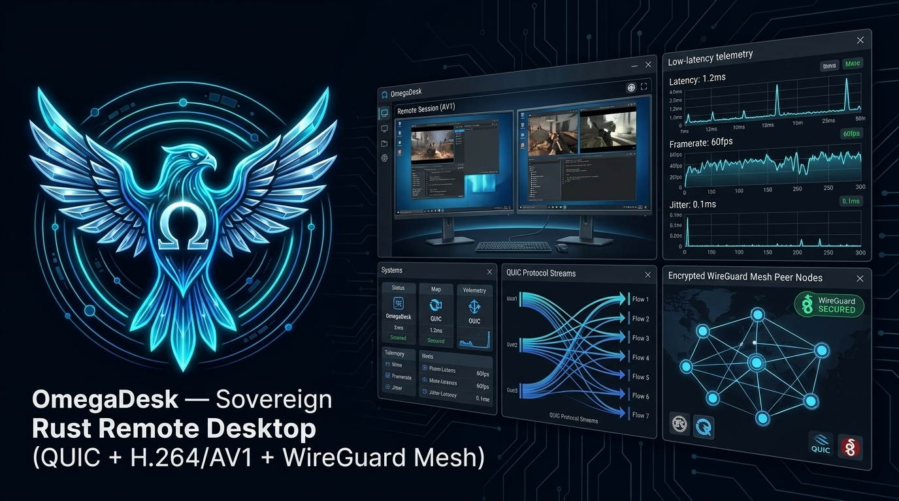

<h1>
  
  OmegaDesk Community &amp; Working Groups (<code>COMMUNITY.md</code>)
</h1>

**Bilingual (`English` &amp; `Português pt-BR`) Open-Source Remote Desktop, Zero-Trust Mesh &amp; Systems Engineering Community**

 

[**Home (`README.md`)**](README.md) · [**Projects & Roadmap (`PROJECTS.md`)**](PROJECTS.md) · [**Detailed Plan (`docs/plan.md`)**](docs/plan.md) · [**Official Wiki**](https://github.com/OmegaSoftDLL/omegadesk/wiki) · [**GitHub Discussions**](https://github.com/OmegaSoftDLL/omegadesk/discussions) · [**Contributing (`CONTRIBUTING.md`)**](CONTRIBUTING.md) · [**Security (`SECURITY.md`)**](SECURITY.md)

 

---

## 1. Welcome to the OmegaDesk Community (`EN` / `PT-BR`)

Welcome to the official community of **OmegaDesk** — the self-hosted, low-latency remote desktop, zero-trust mesh, and RMM platform written in pure Rust.

> 🇧🇷 **Boas-vindas à Comunidade OmegaDesk em Português (`pt-BR`):**
> A comunidade oficial do OmegaDesk é bilíngue (**Inglês** e **Português Brasileiro**). Participe das [Discussões no GitHub](https://github.com/OmegaSoftDLL/omegadesk/discussions), consulte a [Wiki Oficial](https://github.com/OmegaSoftDLL/omegadesk/wiki) e colabore nos grupos de trabalho de captura de vídeo por hardware, transporte QUIC/WireGuard, segurança Zero-Trust e RMM!

---

## 2. Working Groups & Focus Areas

| Working Group | Crates & Scope | Key Engineering Challenges |
| :--- | :--- | :--- |
| **WG-Capture-Codec** | `omegadesk-capture`, `omegadesk-codec`, `drivers/idd` | Zero-copy `DXGI`/`D3D11`, `NVENC`/`QuickSync`/`AMF`, `IddCx` virtual displays, Linux `PipeWire`, macOS `ScreenCaptureKit` |
| **WG-QUIC-Mesh** | `omegadesk-transport`, `omegadesk-mesh`, `omegadesk-magicsock`, `omegadesk-relay` | QUIC TLS 1.3, Noise `IK`, STUN + `disco` hole punching across symmetric NATs, `1.5 s` DERP fallback |
| **WG-ZeroTrust-PAM** | `omegadesk-server`, `omegadesk-identity` | `HuJSON` ACL compilation, per-session TOTP step-up MFA, `.odrec` recording, dynamic video watermark, DLP |
| **WG-RMM-Web** | `omegadesk-rmm-agent`, `omegadesk-server`, `web/` | Fleet inventory, automated alert checks, remote script execution, `WebCodecs` browser gateway |

---

## 3. Governance, Code of Conduct & Security

- **Contributions & DCO Sign-Off:** See [`CONTRIBUTING.md`](CONTRIBUTING.md) (`git commit -s`).
- **Code of Conduct:** Governed by the Contributor Covenant in [`CODE_OF_CONDUCT.md`](CODE_OF_CONDUCT.md).
- **Security Advisories:** Report vulnerabilities privately via [`SECURITY.md`](SECURITY.md) — never in public issues.
