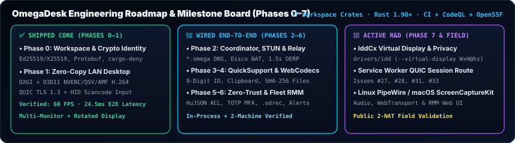

<h1>
  
  OmegaDesk Project Board &amp; 8-Phase Engineering Roadmap (<code>PROJECTS.md</code>)
</h1>

**Quadro Oficial de Engenharia, Arquitetura de 17 Crates e Horizonte de Validação em Campo (`EN` / `PT-BR`)**

 

[**Home (`README.md`)**](README.md) · [**Detailed Engineering Plan (`docs/plan.md`)**](docs/plan.md) · [**Community (`COMMUNITY.md`)**](COMMUNITY.md) · [**Official Wiki**](https://github.com/OmegaSoftDLL/omegadesk/wiki) · [**GitHub Issues**](https://github.com/OmegaSoftDLL/omegadesk/issues) · [**Discussions**](https://github.com/OmegaSoftDLL/omegadesk/discussions)

 

---

## 1. Executive Summary (`EN` / `PT-BR`)

- **🇬🇧 English:** Every subsystem of **OmegaDesk** is tracked across **8 deterministic engineering phases (`Phases 0–7`)** documented in detail in [`docs/plan.md`](docs/plan.md). We strictly distinguish between **shipped & field-verified capabilities (`✅`)**, **end-to-end wired capabilities verified in-process (`🔶`)**, and **library-level or planned work (`🧩` / `⬜`)**.
- **🇧🇷 Português (`pt-BR`):** O roteiro de engenharia do **OmegaDesk** é dividido em **8 fases (`Fases 0 a 7`)** documentadas em [`docs/plan.md`](docs/plan.md), separando com transparência o que já está validado em produção/LAN (`✅`), o que já está integrado ponta a ponta nos binários (`🔶`) e o que ainda está em validação de campo ou biblioteca (`🧩`).

---

## 2. Phase-by-Phase Delivery Matrix

| Phase | Milestone & Scope | Primary Crates & Binaries | Current Status |
| :--- | :--- | :--- | :--- |
| **Phase 0** | **Foundation, Crypto Identity & CI** | `omegadesk-protocol`, `omegadesk-identity`, `deny.toml` | ✅ **Done** — Ed25519/X25519 keys, OS keychain, Protobuf framing, 3-OS CI + CodeQL |
| **Phase 1** | **Sub-30ms Zero-Copy LAN Desktop** | `omegadesk-capture`, `omegadesk-codec`, `omegadesk-transport`, `omegadesk-input`, `omegadesk-agent`, `omegadesk-client` | ✅ **Done** — DXGI capture, D3D11 zero-copy H.264 (`NVENC`/`QSV`/`AMF`), QUIC TLS 1.3, **60 FPS @ 24.5 ms E2E** |
| **Phase 2** | **Mesh Network, Coordinator & Relay** | `omegadesk-noise`, `omegadesk-mesh`, `omegadesk-control`, `omegadesk-magicsock`, `omegadesk-server`, `omegadesk-relay` | 🔶 **Wired End-to-End** — `*.omega` DNS, STUN + `disco` hole punching, 1.5s DERP relay fallback |
| **Phase 3** | **QuickSupport, Clipboard, Files & Service** | `omegadesk-quicksupport`, `omegadesk-service`, `omegadesk-agent` | 🔶 **Wired End-to-End** — 9-digit QuickSupport ID, SHA-256 resumable file transfer, clipboard sync, multi-monitor, adaptive QoS ([#27](https://github.com/OmegaSoftDLL/omegadesk/issues/27)) |
| **Phase 4** | **Browser Client (`WebCodecs` Gateway)** | `omegadesk-server` (`--web-listen`), `web/` | 🔶 **Wired End-to-End** — WebSocket-to-mesh proxy, `WebCodecs` H.264 decode, keyboard/mouse injection ([#28](https://github.com/OmegaSoftDLL/omegadesk/issues/28)) |
| **Phase 5** | **Zero-Trust `HuJSON` Policies, MFA & `.odrec`** | `omegadesk-server` (`--policy`), `omegadesk-agent` (`--totp-secret`, `--recordings-dir`, `--audit-log`) | 🔶 **Wired End-to-End** — Identity-filtered netmaps, per-session TOTP MFA, `.odrec` recording, clipboard quotas, video watermark, JSONL audit |
| **Phase 6** | **Fleet RMM (Inventory, Alerts & Scripts)** | `omegadesk-rmm-agent`, `omegadesk-server admin` | 🔶 **Wired End-to-End** — 15-min hardware/OS/process inventory, threshold checks, remote PowerShell/`sh`/`cmd` execution, deployment tokens (`odl_...`) |
| **Phase 7** | **Virtual Displays (`IddCx`), Cross-Platform & Protocols** | `drivers/idd`, `omegadesk-capture` | 🔶 **Active R&D** — Signed `IddCx` virtual display (`--virtual-display <WxH@hz>`) & privacy blanking wired; Linux/macOS capture & RDP/VNC/MCP integration tracked in [#31](https://github.com/OmegaSoftDLL/omegadesk/issues/31), [#33](https://github.com/OmegaSoftDLL/omegadesk/issues/33) |

---

## 3. Active Engineering Issues & Verification Priorities

- [**Issue #27**](https://github.com/OmegaSoftDLL/omegadesk/issues/27) — Phase 3 completion: route the live QUIC session directly through the Windows `LocalSystem` per-session worker (`omegadesk-service`), wire Opus audio, chat, and remote terminal.
- [**Issue #28**](https://github.com/OmegaSoftDLL/omegadesk/issues/28) — Phase 4 completion: benchmark browser `WebCodecs` latency against the native `winit` client and add `WebTransport` + operator web dashboard.
- [**Issue #31**](https://github.com/OmegaSoftDLL/omegadesk/issues/31) & [**Issue #33**](https://github.com/OmegaSoftDLL/omegadesk/issues/33) — Phase 7 completion: Linux PipeWire / X11 & macOS ScreenCaptureKit backends, plus production wiring for compatibility crates.
