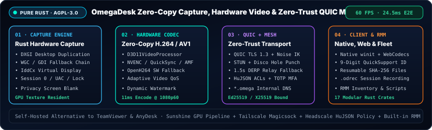

<link rel="icon" type="image/svg+xml" href="favicon.svg" />
<link rel="icon" type="image/png" sizes="64x64" href="favicon.png" />
<link rel="alternate icon" type="image/x-icon" href="favicon.ico" />
<link rel="apple-touch-icon" sizes="180x180" href="apple-touch-icon.png" />

<h1>
  
  OmegaDesk — Sovereign Self-Hosted Remote Desktop in Pure Rust
</h1>

**Zero-Copy Hardware H.264/AV1 · QUIC TLS 1.3 + Built-in WireGuard/Disco Mesh · Zero-Trust `HuJSON` Policy &amp; TOTP MFA · QuickSupport &amp; Fleet RMM**

 

[**Repository (`README.md`)**](https://github.com/OmegaSoftDLL/omegadesk) · [**Detailed Engineering Plan (`plan.md`)**](plan.md) · [**Projects &amp; Roadmap (`PROJECTS.md`)**](PROJECTS.md) · [**Community (`COMMUNITY.md`)**](COMMUNITY.md) · [**Wiki (`wiki/Home.md`)**](wiki/Home.md) · [**Why Rust (`language.md`)**](language.md) · [**Reference Ecosystem (`references.md`)**](references.md) · [**Virtual Display Drivers (`driver-references.md`)**](driver-references.md)

---

## 🌐 Overview (`EN` / `PT-BR`)

- **🇬🇧 English:** **OmegaDesk** is an open-source (`AGPL-3.0`), self-hosted remote desktop, zero-trust mesh access, and fleet RMM platform written in **100% Rust (`17` workspace crates)**. It combines `DXGI` + zero-copy `D3D11` hardware H.264 encoding (`NVENC`/`QuickSync`/`AMF`, **60 FPS @ 24.5 ms E2E latency**), **QUIC (TLS 1.3)** over a Tailscale-style **`magicsock` STUN/Disco + DERP relay mesh** (`*.omega` names), **`HuJSON` zero-trust access policies** with per-session TOTP MFA and `.odrec` recording, 9-digit **QuickSupport**, Windows `LocalSystem` unattended service + `IddCx` virtual displays, `WebCodecs` browser gateway, and built-in **CLI RMM**.
- **🇧🇷 Português (`pt-BR`):** O **OmegaDesk** é uma plataforma aberta (`AGPL-3.0`) e auto-hospedada de acesso remoto de baixa latência, rede mesh Zero-Trust e RMM escrita em **Rust puro (`17` crates)**, projetada como alternativa soberana ao TeamViewer e AnyDesk.

---

## 📚 Official Documentation & Wiki Index

1. [**Wiki Home (`wiki/Home.md`)**](wiki/Home.md) — Executive overview, 17-crate map, and bilingual (`EN` / `PT-BR`) navigation.
2. [**Getting Started (`wiki/Getting-Started.md`)**](wiki/Getting-Started.md) — Direct LAN mode, Mesh coordinator & relay deployment, QuickSupport, Browser gateway, and Windows service installation.
3. [**Architecture & QUIC Transport (`wiki/Architecture-and-QUIC-Transport.md`)**](wiki/Architecture-and-QUIC-Transport.md) — Protobuf framing, QUIC TLS 1.3 streams, Noise `IK` control channel, and `omegadesk-magicsock`.
4. [**Hardware Encoding & Capture (`wiki/Hardware-Encoding-and-Capture.md`)**](wiki/Hardware-Encoding-and-Capture.md) — `DXGI Desktop Duplication`, zero-copy `D3D11VideoProcessor`, `NVENC`/`QSV`/`AMF` Media Foundation, `IddCx` virtual displays, and adaptive video QoS.
5. [**WireGuard Mesh & Zero-Trust Security (`wiki/WireGuard-Mesh-and-Zero-Trust-Security.md`)**](wiki/WireGuard-Mesh-and-Zero-Trust-Security.md) — `HuJSON` `policy/v2` ACLs, identity-filtered netmaps, per-session TOTP MFA, `.odrec` session recording, dynamic video watermark, and JSONL auditing.
6. [**Self-Hosting Relay & Server (`wiki/Self-Hosting-Relay-and-Server.md`)**](wiki/Self-Hosting-Relay-and-Server.md) — Running `omegadesk-relay` (STUN + DERP) and `omegadesk-server` (Coordinator + WebCodecs Gateway + RMM Admin API).
7. [**Roadmap & Benchmarks (`wiki/Roadmap-and-Benchmarks.md`)**](wiki/Roadmap-and-Benchmarks.md) — Latency breakdown (`24.5 ms` E2E at `1080p60`) and Phases 0–7 status matrix.
