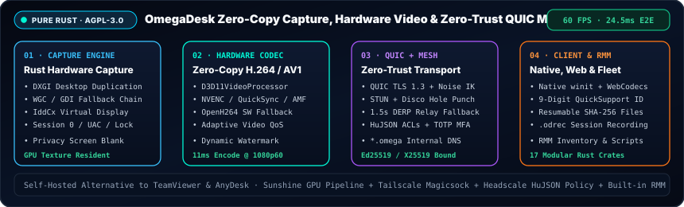

<h1>
  
  OmegaDesk Official Wiki — Sovereign Self-Hosted Remote Desktop in Pure Rust
</h1>

**Zero-Copy Hardware H.264/AV1 · QUIC TLS 1.3 + Built-in WireGuard/Disco Mesh · Zero-Trust `HuJSON` Policy &amp; TOTP MFA · QuickSupport &amp; Fleet RMM**

 

---

## 🌐 Welcome (`EN` / `PT-BR`)

- **🇬🇧 English:** Welcome to the official technical Wiki for **OmegaDesk** (`https://github.com/OmegaSoftDLL/omegadesk`), the open-source (`AGPL-3.0`), self-hosted remote desktop, zero-trust mesh, and fleet RMM platform written from scratch in **Rust 1.90+ (`17` workspace crates)**.
- **🇧🇷 Português (`pt-BR`):** Bem-vindo à Wiki oficial do **OmegaDesk**, a plataforma soberana e auto-hospedada de área de trabalho remota de baixa latência (`24,5 ms` ponta a ponta a `60 FPS`), malha Zero-Trust QUIC/Disco e gerenciamento de frota (RMM) escrita em **Rust puro**.

---

## 🧭 Wiki Pages Directory

| Page | Topics Covered |
| :--- | :--- |
| [**1. Getting Started**](Getting-Started) | Building with `cargo`, Direct LAN connections, Mesh Coordinator + Relay setup, 9-Digit QuickSupport, Browser `WebCodecs` gateway, and Windows `LocalSystem` service |
| [**2. Architecture & QUIC Transport**](Architecture-and-QUIC-Transport) | 17-crate workspace layout, QUIC (TLS 1.3) video/control/file streams, Ed25519/X25519 device identities, and HID scancode injection |
| [**3. Hardware Encoding & Capture**](Hardware-Encoding-and-Capture) | `DXGI Desktop Duplication`, zero-copy `D3D11` GPU texture pipeline (`NVENC`, `QuickSync`, `AMF`), `OpenH264` fallback, `IddCx` virtual display, and Adaptive Video QoS |
| [**4. WireGuard Mesh & Zero-Trust Security**](WireGuard-Mesh-and-Zero-Trust-Security) | STUN + `disco` hole punching, `1.5 s` DERP relay fallback, Headscale-style `HuJSON` ACLs, per-session TOTP MFA, `.odrec` recording, watermarks, and DLP |
| [**5. Self-Hosting Relay & Server**](Self-Hosting-Relay-and-Server) | Deploying `omegadesk-relay` and `omegadesk-server`, pre-auth keys (`odk_...`), deployment links (`odl_...`), and `omegadesk-server admin` RMM fleet operations |
| [**6. Roadmap & Benchmarks**](Roadmap-and-Benchmarks) | Frame-by-frame latency telemetry (`24.5 ms` @ `1080p60`), Phases 0–7 engineering board, and open validation milestones |
