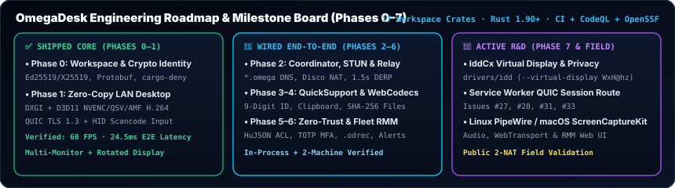

# Roadmap & Latency Benchmarks

## 1. End-to-End Latency Breakdown (`1920×1080 @ 60 FPS`)

Measured on Intel Core Ultra 5 135U (`1920×1080`, zero-copy `DXGI` + Media Foundation Hardware H.264):

| Pipeline Stage | Measured Time | Notes |
| :--- | :---: | :--- |
| **1. Capture + GPU NV12 Conversion** | `4.0 ms` | `DXGI Desktop Duplication` + `ID3D11VideoProcessor` |
| **2. Hardware H.264 Encoding** | `11.0 ms` | `MFCreateDXGISurfaceBuffer` (`QuickSync` / `NVENC` / `AMF`) |
| **3. QUIC TLS 1.3 Loopback / LAN** | `0.2 ms` | Multiplexed QUIC media stream |
| **4. Client H.264 Decode** | `6.0 ms` | Low-delay frame decode |
| **5. Frame Presentation (`winit`)** | `3.3 ms` | Direct window surface draw |
| **Total End-to-End Latency** | **`24.5 ms` (`60 FPS`)** | Sub-30ms target achieved in Phase 1 |

---

## 2. Complete 8-Phase Engineering Matrix

See [**`PROJECTS.md`**](https://github.com/OmegaSoftDLL/omegadesk/blob/main/PROJECTS.md) and [**`docs/plan.md`**](https://github.com/OmegaSoftDLL/omegadesk/blob/main/docs/plan.md) for the live tracker:
- **Phase 0 (Foundation & Crypto Identity):** ✅ Done
- **Phase 1 (Sub-30ms Zero-Copy LAN Desktop):** ✅ Done
- **Phase 2 (Mesh Network, Coordinator & Relay):** 🔶 Wired End-to-End
- **Phase 3 (QuickSupport, Service, Clipboard & Files):** 🔶 Wired End-to-End ([#27](https://github.com/OmegaSoftDLL/omegadesk/issues/27))
- **Phase 4 (Browser `WebCodecs` Client & Gateway):** 🔶 Wired End-to-End ([#28](https://github.com/OmegaSoftDLL/omegadesk/issues/28))
- **Phase 5 (Zero-Trust `HuJSON` Policy, MFA & `.odrec`):** 🔶 Wired End-to-End
- **Phase 6 (Fleet RMM — Inventory, Checks & Scripts):** 🔶 Wired End-to-End
- **Phase 7 (Virtual Display `IddCx`, Cross-Platform & Protocols):** 🔶 Active R&D ([#31](https://github.com/OmegaSoftDLL/omegadesk/issues/31), [#33](https://github.com/OmegaSoftDLL/omegadesk/issues/33))
