### **OmegaDesk Wiki**
`Rust 1.90+ · QUIC · Zero-Trust`

 

---

- 🏠 [**Home**](Home)
- 🚀 [**Getting Started**](Getting-Started)
- ⚡ [**Architecture & QUIC Transport**](Architecture-and-QUIC-Transport)
- 🖥️ [**Hardware Encoding & Capture**](Hardware-Encoding-and-Capture)
- 🛡️ [**WireGuard Mesh & Zero-Trust**](WireGuard-Mesh-and-Zero-Trust-Security)
- 🏢 [**Self-Hosting Relay & Server**](Self-Hosting-Relay-and-Server)
- 📊 [**Roadmap & Benchmarks**](Roadmap-and-Benchmarks)

---

**Project Links**
- 📦 [Main Repository](https://github.com/OmegaSoftDLL/omegadesk)
- 📋 [Projects Board (`PROJECTS.md`)](https://github.com/OmegaSoftDLL/omegadesk/blob/main/PROJECTS.md)
- 📐 [Full Spec (`docs/plan.md`)](https://github.com/OmegaSoftDLL/omegadesk/blob/main/docs/plan.md)
- 💬 [Discussions (`EN` / `PT-BR`)](https://github.com/OmegaSoftDLL/omegadesk/discussions)
